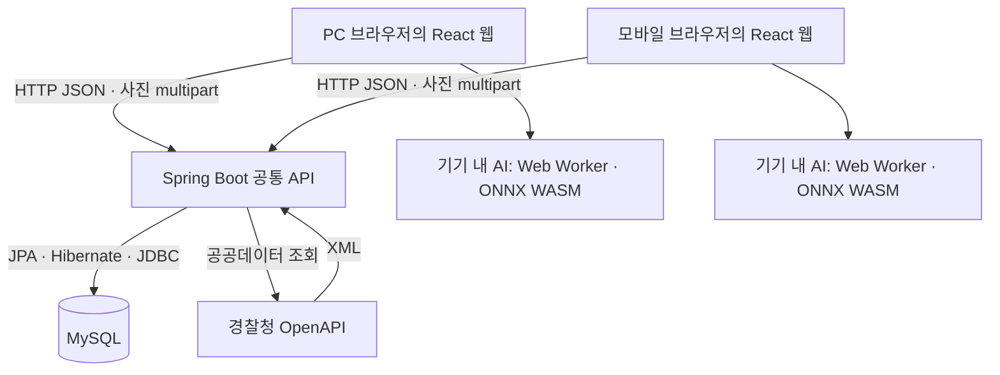

# LOST QUEST 아키텍처와 구현 해설

작성 기준: 2026-10-21의 이 저장소 코드. 발표를 준비하는 기획자가 전체 구조와 주요 구현을 설명할 수 있도록 작성했다. 실행 중인 서버·실제 DB·공개 사이트의 최신 상태를 점검한 보고서는 아니다. 버전은 프로젝트의 선언을 기준으로 하며 설치된 정확한 패치 버전은 lockfile에 따라 달라질 수 있다.

## 1. 프로젝트를 한 문장으로 설명하기

**LOST QUEST는 회원이 등록한 분실물·습득물과 경찰청 공공데이터를 탐색하고, 조건 기반 추천과 기기 내 AI 비교를 참고하여 물건을 찾은 뒤, 소유자 확인·QR 검증·관리자 확인으로 반환을 진행하는 웹 서비스다.**

웹 화면과 모바일 화면은 React로 만들었고, 공통 업무 처리는 Java/Spring Boot 백엔드가 담당한다. 회원 기록은 MySQL에 저장한다. 웹·모바일은 같은 API를 사용하는 두 개의 화면 구현이다.

발표에서 구분할 것:

- 조건 기반 매칭 점수와 AI 참고 점수는 별개다.
- 모바일 버전은 브라우저에서 실행하는 모바일 웹이다.
- 주요 기능은 서버 DB를 사용하지만 게임 랭킹처럼 기기에만 저장하는 기능도 있다.
- Python 이미지 유사도 서버는 독립 실험 코드이며 현재 Java 백엔드와 연결되지 않았다.
- 이 문서의 구현 설명과 실제 공개 사이트에 배포된 버전은 다를 수 있다.

## 2. 네 개의 실행 프로세스와 세 개의 역할 계층

| 실행 구성 | 디렉터리 | 기본 포트 | 담당 역할 |
| --- | --- | --- | --- |
| 웹 개발 서버 | `frontend/` | 5173 | PC 중심 React 화면과 개발용 파일 제공 |
| 모바일 개발 서버 | `frontend-mobile/` | 5174 | 앱 형태의 React 화면과 개발용 파일 제공 |
| 공통 API 서버 | `backend/` | 8081 | 로그인·권한·물품·반환·커뮤니티·외부 API 처리 |
| DB 서버 | 별도로 설치한 MySQL | 3306 | 회원과 서비스 기록의 영속 저장 |

포트는 한 컴퓨터에서 실행되는 프로그램을 구분하는 출입구다. `127.0.0.1`은 지금 접속하는 기기 자신을 뜻한다. 실제 포트는 실행 환경변수로 바뀔 수 있다.

네 프로세스를 띄워도 구조적 역할은 **표현 계층 → 애플리케이션 계층 → 데이터 계층**의 세 계층이다. 웹·모바일이 표현 계층을 나누어 제공한다. 하나의 저장소에 여러 실행 프로젝트가 있으므로 저장소 구성은 모노레포라고 부를 수 있다. 백엔드는 하나의 Spring Boot 애플리케이션으로 구성된 계층형 모놀리스다. 도메인별 클래스가 나뉘어 있다는 이유로 마이크로서비스가 되는 것은 아니다.



개발 서버는 React 파일을 브라우저에 제공한다. 화면 코드가 실제로 실행되는 곳은 브라우저다. Node.js가 회원가입·반환 업무를 처리하는 구조는 아니다. 그 업무는 Java 서버가 처리한다.

웹만 확인하면 MySQL·백엔드·웹 개발 서버를, 모바일만 확인하면 MySQL·백엔드·모바일 개발 서버를 실행하면 된다. 두 화면을 동시에 보여 줄 때 네 프로세스를 모두 실행한다.

## 3. 언어·라이브러리·실행 도구 구분

| 종류 | 사용 기술 | 이 프로젝트에서의 역할 |
| --- | --- | --- |
| 프론트엔드 언어 | TypeScript, TSX | 화면 로직과 데이터 타입 작성 |
| 화면 표현·스타일 | HTML 구조, CSS, SVG | 배치·색상·반응형·아이콘·기본 물품 그림 |
| UI 라이브러리 | React 19 계열 | 컴포넌트와 상태를 바탕으로 화면 갱신 |
| 라우팅 | React Router 7 계열 | 주소별 페이지와 뒤로 가기 |
| 개발·배포 빌드 | Vite 7 계열, TypeScript 5.9 계열 | 개발 서버, 타입 검사, 정적 파일 묶음 생성 |
| 스타일 도구 | CSS 및 Tailwind CSS 4 관련 설정 | 현재 화면의 주요 세부 배치는 CSS 파일에 구현 |
| 아이콘·QR | Lucide React, qrcode.react | 화면 아이콘과 QR 그림 생성 |
| 자바스크립트 실행·패키지 관리 | Node.js, npm | Vite 실행, 의존성 설치, 테스트·빌드 명령 실행 |
| 백엔드 언어 | Java 21 | 서버 업무 규칙 작성 |
| 서버 프레임워크 | Spring Boot 3.5.16 | 서버 실행과 설정·구성요소 관리 |
| HTTP 처리 | Spring Web MVC, 내장 Tomcat | 요청을 컨트롤러로 전달하고 JSON 응답 생성 |
| 인증·권한 | Spring Security, JWT, BCrypt | 로그인 토큰 검증과 비밀번호 해시 |
| DB 접근 | Spring Data JPA, Hibernate, MySQL JDBC 드라이버 | Java 객체와 DB 행을 연결하고 SQL 실행 |
| DB 언어·DBMS | SQL, MySQL 8.x | 스키마·조회·관계·제약조건·트랜잭션 |
| Java 빌드 | Maven, Maven Wrapper | 의존성 관리, 컴파일, 테스트, 실행 JAR 생성 |
| 브라우저 AI | Transformers.js, ONNX Runtime Web, WebAssembly | 학습된 모델을 사용자 기기에서 실행 |
| 독립 AI 실험 | Python, FastAPI, PyTorch, OpenCLIP | 별도 이미지 임베딩 실험 |
| 테스트 | Vitest·jsdom·fake-indexeddb, JUnit·Spring Boot Test·H2, pytest | 클라이언트·서버·실험 코드 검증 |

React는 언어가 아니라 UI 라이브러리이고, Spring Boot는 언어가 아니라 서버 프레임워크다. MySQL은 DB 서버이고, SQL은 그 DB를 다루는 언어다. TSX는 TypeScript 안에서 HTML과 비슷한 UI 표현을 작성하는 문법이다. 브라우저는 빌드된 JavaScript를 실행한다.

## 4. 디렉터리 지도

```text
LOST_QUEST/
├─ frontend/                   웹 프론트엔드
│  ├─ src/pages/               화면 단위
│  ├─ src/components/          재사용 UI
│  ├─ src/context/             로그인·계정 기록·알림 상태
│  ├─ src/services/            API 호출·응답 변환·저장소 처리
│  ├─ src/features/            사진·텍스트 AI와 종합 비교
│  ├─ config/                  AI 모델 메타데이터
│  ├─ scripts/                 모델 준비 도구
│  └─ public/                  정적 이미지·모델·WASM 파일 위치
├─ frontend-mobile/            같은 API를 사용하는 모바일 웹
├─ backend/
│  ├─ src/main/java/com/lostquest/
│  │  ├─ controller/          HTTP 요청·응답
│  │  ├─ service/             업무 규칙·트랜잭션
│  │  ├─ repository/          JPA 데이터 접근
│  │  ├─ entity/              DB 매핑 객체
│  │  ├─ dto/                 API 입출력 객체
│  │  ├─ security/            JWT·Security 설정
│  │  ├─ client/              경찰청 HTTP 호출·XML 파싱
│  │  ├─ config/              CORS·설정값·입력 제한
│  │  └─ exception/           공통 오류 응답
│  ├─ src/main/resources/     공개 가능한 기본 설정
│  └─ src/test/               자동 테스트와 테스트 전용 설정
├─ ai/image-similarity/        Java 서버와 분리된 Python PoC
├─ docs/                       기능·배포·실험 문서
└─ 계획서및회의록/              기획·실행 안내·SQL 변경 기록
```

## 5. 프론트엔드가 화면을 만드는 방식

앱은 SPA(Single Page Application)다. `main.tsx`가 React를 시작하고 `BrowserRouter`와 상태 Provider로 앱을 감싼다. `App.tsx`가 주소와 화면을 연결한다. 사용자가 이동하면 Router가 표시할 React 컴포넌트를 바꾼다. SPA여도 조회·등록·반환에는 서버 통신이 필요하다.

| 프론트 계층 | 예시 | 책임 |
| --- | --- | --- |
| 페이지 | `RegisterPage.tsx`, `SearchPage.tsx`, `MyPage.tsx` | 화면 전체와 사용자 동작 |
| 컴포넌트 | `ItemCard.tsx`, `ProfileSettings.tsx`, `Layout.tsx` | 카드·폼·메뉴 등 재사용 UI |
| Context | `AppContext.tsx`, `MatchNotificationContext.tsx` | 여러 화면이 공유하는 상태 |
| API 서비스 | `itemApi.ts`, `authApi.ts`, `activityApi.ts` | 요청 생성·응답 검증·화면 데이터 변환 |
| 공통 통신 | `apiClient.ts` | fetch, JSON, multipart, 토큰, 타임아웃, 오류 변환 |
| AI 기능 | `features/imageAnalysis`, `features/textMatching` | Worker와 모델 실행·수학 계산 |

`useState`는 입력값·로딩 여부 같은 화면 상태, `useEffect`는 조회·구독·해제, `useContext`는 공유 상태를 읽는 데 사용한다. 상태를 바꾸면 React가 필요한 UI를 다시 그린다. Context의 데이터는 서버에서 받은 기록을 현재 화면에서 쓰기 위한 메모리이며 MySQL의 대체 저장소가 아니다.

페이지 일부는 `lazy`와 `Suspense`로 필요할 때 불러온다. AI 모델도 기능을 실행하는 시점에 준비한다. 페이지를 처음 열자마자 모든 큰 기능을 한꺼번에 실행하지 않기 위한 구조다.

## 6. 웹과 모바일의 관계

`frontend-mobile/`은 웹 코드를 복사해 화면 구성과 탐색 방식을 모바일에 맞춘 별도 Vite 프로젝트다. 상단 앱 바, 하단 홈·탐색·등록·매칭·마이 탭, 전체 메뉴 시트와 최대 폭 480px 중심의 단일 열 레이아웃을 사용한다.

두 프론트엔드는 같은 기술과 같은 백엔드 API 계약을 사용한다. 별도의 모바일 DB나 모바일 전용 Java 서버는 없다. 현재 구조에는 공통 컴포넌트·API 코드를 하나의 공유 패키지로 묶는 체계가 없어 같은 기능이 두 디렉터리에 중복된다. 공통 기능 수정 시 양쪽 반영 여부를 확인해야 한다.

최근 모바일 마이페이지의 예:

- `/mypage`에서 등록·반환 내역을 아래쪽 탭으로 보여 준다.
- `/mypage/settings`는 내 정보 수정 화면이다.
- `/mypage/badges`는 업적 화면이다.
- 상단 뒤로 가기는 원래 마이페이지로 돌아가도록 처리하며 직접 주소로 연 경우의 복귀 경로도 있다.

이는 브라우저 안의 화면 이동이다. React Native·Flutter·Swift·Kotlin으로 만든 설치형 앱은 현재 저장소에 없다. 오프라인 공개 목록 저장은 있지만 Service Worker로 앱 전체를 오프라인 설치·실행하는 PWA 구현과는 범위가 다르다.

## 7. API와 통신 방식

API는 프론트엔드가 백엔드에 요청하는 공개된 기능 규약이다. REST 방식으로 자원의 주소와 HTTP 동작을 구분한다.

| 동작 | HTTP 예시 | 의미 |
| --- | --- | --- |
| 조회 | `GET /api/lost-items` | 분실물 목록 |
| 등록 | `POST /api/lost-items` | 새 분실물 |
| 수정 | `PUT /api/lost-items/12` | 12번 글 수정 |
| 삭제 | `DELETE /api/lost-items/12` | 12번 글 삭제 처리 |
| 로그인 | `POST /api/auth/login` | 이메일·비밀번호 확인과 토큰 발급 |
| 내 등록 기록 | `GET /api/me/items` | 로그인 사용자 소유 기록 |
| 추천 | `GET /api/lost-items/12/matches` | 내 분실물의 추천 후보 |
| 공공데이터 | `GET /api/public-items/found` | 백엔드가 중계하는 경찰청 습득물 |
| 커뮤니티 | `GET /api/community/posts` | 게시판 목록 |
| 반환 | `POST /api/returns` | 반환 요청 생성 |

일반 데이터는 JSON으로 주고받는다. 사진이 있으면 JSON `item` 파트와 파일 `image` 파트를 `multipart/form-data`로 함께 보낸다. 이미지 조회 응답은 JSON이 아니라 이미지 바이트다. DB와 백엔드 사이의 JDBC 연결도 브라우저의 HTTP API와는 다른 통신이다.

보통 성공은 200, 생성은 201, 삭제 응답은 204다. 잘못된 입력은 400, 인증 필요·토큰 오류는 401, 권한 없음은 403, 대상 없음은 404, 상태 충돌은 409 등으로 구분한다. `ApiError`와 전역 예외 처리기가 `code`, `message`, `errors` 등을 같은 형식으로 반환해 화면에서 일관되게 안내한다.

## 8. API 주소·CORS·모바일 프록시

`VITE_API_BASE_URL`은 프론트엔드가 API 요청을 어디로 보낼지 지정하는 공개 설정이다. `/api`는 호출 코드가 붙이므로 기본 주소만 넣는다. 비어 있으면 앱이 설정 오류를 표시한다. Vite 환경값은 개발 서버 시작 또는 빌드 시 반영되므로 변경 후 재시작·재빌드가 필요하다.

웹을 백엔드에 직접 연결하는 로컬 예:

```text
브라우저 화면: http://127.0.0.1:5173
VITE_API_BASE_URL: http://127.0.0.1:8081
요청: http://127.0.0.1:8081/api/lost-items
```

Origin은 프로토콜·호스트·포트의 조합이다. 5173과 8081도 다른 Origin이며 `localhost`와 `127.0.0.1`도 다르다. CORS는 브라우저의 다른 Origin 요청을 서버가 허용할지 정하는 정책이고 로그인 권한을 대신하지 않는다.

현재 모바일 개발 설정은 다음처럼 프록시를 사용한다.

```text
모바일 브라우저 → 127.0.0.1:5174/api/...
                 Vite 개발 프록시 → 127.0.0.1:8081/api/...
```

모바일에서 `VITE_API_BASE_URL`을 5174로 두는 이유다. 프록시 목적지는 `DEV_API_PROXY_TARGET`이며 기본 8081이다. 현재 개발 프록시는 전달할 때 Origin 헤더를 제거한다. 이 프록시는 Vite 개발 기능이므로 정적 배포 후에도 자동으로 생기는 API 서버라고 생각하면 안 된다. 배포에서는 실제 접근 가능한 API 주소·HTTPS·CORS 설정이 필요하다.

## 9. 백엔드의 계층과 코드 읽는 순서

```text
HTTP 요청
  → Spring Security: 토큰 확인
  → Controller: 경로·입력·인증 주체 받기
  → Service: 작성자 권한·업무 규칙·트랜잭션
  → Repository: DB 조회·저장
  → Hibernate/JDBC → MySQL
  → Entity를 DTO로 변환 → JSON 응답
```

분실물의 대표 파일은 `LostItemController` → `LostItemService` → `LostItemRepository` → `LostItem`이다. 컨트롤러는 Service를 호출하고 Repository를 직접 사용하지 않는다.

- **Controller:** URL과 메서드를 Java 함수에 연결한다. `@Valid` 입력 검증, 인증된 JWT 주체와 파일을 받아 Service에 전달한다.
- **Service:** 본인 글인지, 반환이 진행 중인지, 저장 가능한 사진인지 등 실제 업무를 판단한다.
- **Repository:** `JpaRepository`와 쿼리로 저장·목록·잠금 조회를 제공한다.
- **Entity:** `users`, `lost_items` 같은 테이블에 연결되는 Java 객체다.
- **DTO:** 외부로 받거나 내보낼 필드만 담는다. DB 객체 전체를 그대로 노출하지 않아 비밀번호·정답 해시 같은 정보를 보호한다.

Spring은 생성자에 필요한 객체를 주입한다. 예를 들어 `LostItemService`는 Repository·ImageService 등을 받아 함께 사용한다. 이를 의존성 주입(DI)이라고 한다. 이미지 저장소도 `ImageStorage` 인터페이스 뒤에 두고 현재 `@Primary`인 `DatabaseImageStorage`를 선택한다.

JPA는 Java 객체와 DB 저장을 연결하는 규약, Hibernate는 그 규약의 구현, Spring Data JPA는 Repository 작성의 반복을 줄이는 도구다. Hibernate가 SQL을 만들기도 하고 개발자가 JPQL 쿼리를 작성하기도 한다. SQL을 전혀 사용하지 않는 구조는 아니다.

## 10. 트랜잭션과 동시 요청

트랜잭션은 관련된 변경을 하나의 작업으로 성공시키거나 실패시키는 단위다. 사진·물품·등록 XP·활동 기록을 같은 트랜잭션에서 처리하면 중간 실패 시 일부 기록만 남는 것을 줄일 수 있다.

반환 완료는 반환 상태, 습득물 상태, 연결된 분실물 상태, XP 지급을 함께 바꾼다. 이 중 하나라도 필요한 조건을 만족하지 못하면 완료 작업을 롤백한다.

여러 사람이 동시에 같은 물건의 반환을 요청할 수 있으므로 Repository에서 `PESSIMISTIC_WRITE` 행 잠금을 사용한다. 한 작업이 대상 행을 처리하는 동안 다른 작업이 같은 행을 먼저 바꾸지 못하게 직렬화한다. 이메일 중복·XP 중복·매칭 알림 중복은 DB의 유일 제약조건도 사용한다.

`open-in-view: false`라서 HTTP 응답을 만드는 동안 무제한으로 DB 연결을 유지하는 방식을 사용하지 않는다. 일반적인 Entity→DTO 변환은 Service 트랜잭션 안에서 처리한다. 외부 경찰청 요청이 오래 걸리는 추천 서비스는 큰 트랜잭션으로 감싸지 않고 필요한 DB 읽기를 짧게 끝낸다.

## 11. 데이터베이스 설계

현재 JPA Entity가 매핑하는 주요 테이블은 다음과 같다. 실제 실행 DB에 추가 테이블·뷰가 있는지는 별도 스키마 점검이 필요하다.

| 테이블 | 기록 | 핵심 연결 |
| --- | --- | --- |
| `users` | 이메일·비밀번호 해시·닉네임·역할 | 여러 물품·글·활동 기록의 회원 |
| `lost_items` | 분실물·분실일·장소·상태·사진 경로 | 작성자 `user_id` |
| `found_items` | 습득물·습득일·보관 상태·소유 확인 정보 | 작성자 `user_id` |
| `item_images` | 파일 키와 사진 원본 바이트 | 글의 `image_url`이 조회 경로로 참조 |
| `return_requests` | 반환 단계·신청자·QR 정보·실패 횟수 | 습득물·신청자·선택 분실물 |
| `match_notifications` | 추천 후보·점수·읽음 시각 | 회원·분실물·후보 식별자 |
| `experience_events` | XP 발생 원인과 점수 | 회원·중복 방지 이벤트 키 |
| `activity_notifications` | 등록·반환 등의 활동 메시지 | 회원 |
| `community_posts` | 독립 게시판의 제목·본문·분류·사진 | 작성자·선택 물품 연결 |
| `community_comments` | 공개 댓글 | 게시글·작성자 |
| `community_questions` | 물품의 비공개 질문·답변 | 물품 식별자·글 작성자·질문자 |
| `community_reports` | 물품글 신고·숨김 검토 | 신고자·물품 식별자·관리자 |

회원 한 명이 여러 물품·글을 등록하는 **1:N 관계**다. 반환 한 건은 하나의 습득물과 신청자에 연결되고 필요하면 신청자의 분실물에도 연결한다. 모든 연결이 외래키인 것은 아니다. 분실물/습득물 양쪽을 가리키는 일부 기능은 `item_type + item_id`로 구분한다. 사진도 `image_id` 외래키 대신 파일 키를 포함한 경로를 쓴다.

분실물은 `LOST / RETURNED / CLOSED`, 습득물은 `STORED / RETURNED / CLOSED` 상태를 갖는다. 물품글 삭제는 행을 즉시 지우는 대신 `CLOSED`로 바꾸어 공개 목록에서 제외하는 소프트 삭제다. 관리자 숨김은 별도의 `hidden` 값이다. 반환 진행·완료 이력이 있으면 작성자도 글을 임의 수정·삭제하지 못하게 제한한다.

DB에는 `Instant` 기반 등록 시각을 UTC로 저장하고 화면에서는 한국 시간으로 바꿔 보여 준다. `lostDate`와 `foundDate`는 날짜만 필요한 `LocalDate`다. 글 등록일과 물건을 실제 잃어버린 날짜는 서로 다른 값이다.

개발 프로필은 기본 `ddl-auto=update`로 Entity에 맞추어 테이블을 갱신한다. DB 자체와 계정 생성은 먼저 해야 한다. 운영용 기본값은 `validate`다. SQL 변경 기록은 있지만 Flyway 같은 버전 관리 마이그레이션은 현재 필수 구성에 없다.

## 12. 회원가입·로그인·내 정보 수정

회원가입 흐름:

1. 프론트엔드가 이메일·닉네임·비밀번호를 받는다.
2. 백엔드가 형식·길이를 다시 검증하고 이메일을 정규화한다.
3. 중복 이메일을 검사하고 DB 유일 제약으로 동시 가입 중복도 막는다.
4. 비밀번호를 BCrypt 해시로 바꾸어 `users`에 저장한다.
5. 가입 역할은 서버가 `USER`로 정한다. 요청에서 관리자 역할을 선택할 수 없다.

이메일은 형식 검사이며 실제 메일로 인증번호를 보내 소유권을 증명하는 기능은 현재 가입 흐름에 없다. BCrypt는 복호화해 원문을 읽는 암호화가 아니라 비밀번호를 비교하기 위한 단방향 해시다.

로그인하면 서버가 BCrypt로 비밀번호를 비교하고 HS256 서명 JWT를 발급한다. 토큰에는 사용자 ID, 역할, 발급·만료 시각, 발급자 등이 들어간다. 비밀번호는 담지 않는다. JWT는 서명으로 변조를 검증하는 것이며 내용이 자동으로 비밀 암호문이 되는 것은 아니다.

보호된 요청은 `Authorization: Bearer <token>`을 보낸다. 서버는 서명·만료·발급자를 검사하고 인증된 사용자를 바탕으로 권한을 확인한다. 서버 HTTP 세션을 생성하지 않는 stateless 방식이다. 중요한 관리자 판단은 DB에서 읽은 사용자 역할도 확인한다.

프론트엔드는 토큰을 `sessionStorage`에 저장한다. 같은 탭 새로고침은 유지할 수 있지만 영구 로그인 저장소는 아니다. 기본 토큰 수명은 1시간이다. 브라우저 Origin마다 저장 영역이 달라 5173에서 로그인해도 5174에서 자동 로그인되는 것은 아니다. 같은 계정으로 각 화면에서 로그인할 수 있다.

현재 별도 Refresh Token 흐름이나 토큰 폐기 목록은 없다. 프론트엔드 로그아웃은 저장된 토큰과 화면의 개인 기록을 지운다. 비밀번호 변경은 현재 비밀번호를 확인하고 새 해시를 저장하지만, 이미 발급된 모든 JWT가 즉시 폐기되는 구조라고 설명하면 안 된다.

내 정보 화면은 닉네임과 비밀번호를 바꾼다. 이메일은 로그인 식별자로 고정한다. 닉네임 변경은 회원 행을 갱신하고 이후 작성자 정보에 반영한다.

## 13. 물품·사진 등록과 사진 보존

사진을 포함한 분실물 등록의 전체 흐름:

```text
RegisterPage
  → itemApi: FormData(item JSON + image File)
  → POST /api/lost-items + Bearer 토큰
  → Security: 인증
  → LostItemController: 입력 검증
  → LostItemService: 작성자·업무 규칙 확인
  → ImageService: 사진 검사·UUID 키 발급
  → DatabaseImageStorage: item_images에 사진 바이트 저장
  → lost_items: 물품 내용과 /api/images/{uuid}.png 저장
  → 등록 XP·활동 알림 기록
  → 트랜잭션 커밋 → DTO 응답 → React 화면 갱신
```

사진은 JPEG·PNG·WebP, 10MiB 이하를 허용한다. 브라우저가 보낸 MIME 타입만 믿지 않고 파일 시그니처와 실제 디코드 가능 여부·해상도도 검사한다. 저장 이름은 서버가 UUID로 만들고 원래 사용자 파일명을 경로로 사용하지 않는다.

사진과 경로는 서로 역할이 다르다. 원본 바이트는 `item_images.content`의 LOB에, 물품에는 `/api/images/{uuid}.{ext}` 경로를 저장한다. 화면은 API 기본 주소와 이 경로를 결합해 이미지를 요청한다. `GET /api/images/{filename}`이 바이트를 제공한다.

따라서 새로고침 후에도 서버에서 같은 경로를 받아 같은 사진을 요청할 수 있다. 화면 미리보기용 `blob:` URL은 임시 표현일 뿐 영속 저장값이 아니다. 현재 사진 보존의 근거는 DB에 저장된 바이트와 서버 조회 경로다. 단, DB 기록이 남아 있어도 백엔드가 꺼져 있거나 사진 요청이 실패하면 화면에서 대체 이미지가 보일 수 있다.

`LocalImageStorage`는 과거 디스크 파일을 읽는 호환 경로로 남아 있다. 현재 기본 구현은 `DatabaseImageStorage`이며 기존 파일을 조회할 때 DB에 복사하는 처리도 있다. 모든 사진이 지금도 디스크에만 저장된다고 설명하면 현재 구현과 다르다.

DB에 이미지를 함께 저장하면 데이터 이동과 등록 원자성이 단순해지는 장점이 있다. 반면 사진이 많아지면 DB·백업 크기와 읽기 부하가 커진다. 서비스가 커질 때 객체 스토리지와 CDN으로 옮기는 것은 개선안이다.

## 14. 검색·경찰청 공공데이터

검색 데이터의 원천은 자체 등록 분실물·습득물과 경찰청 분실물·습득물이다. 현재 검색 화면은 자체 등록을 기본으로 열고 사용자가 공공데이터 출처를 선택하면 해당 경찰청 목록을 요청한다. 경찰청 분실물·습득물은 선택한 유형별로 조회한다. 내부적으로 네 종류의 데이터 상태를 독립 관리한다.

자체 등록은 API로 목록을 받은 뒤 브라우저에서 검색·필터·정렬한다. 경찰청은 검색 조건을 백엔드에 전달하고 외부 API 페이지를 읽으며 기본 50건과 더 보기를 사용한다. 자체 물품 목록 전체에 서버 페이지네이션이 적용되어 있다고 설명하면 안 된다. 커뮤니티 게시판은 별도로 서버 페이지네이션을 사용한다.

경찰청 연동은 `브라우저 → 우리 Java API → 경찰청 OpenAPI → XML 파싱 → DTO/JSON → 브라우저` 순서다. 인증키를 브라우저에 넣지 않고 백엔드에서 관리한다. 분실물·습득물·공통코드 서비스의 키가 나뉜다. XML 파서는 외부 엔티티와 DTD를 차단한다.

현재 경찰청 목록은 기본 12시간 서버 메모리 캐시를 사용한다. 동일 조건의 동시 요청은 한 조회를 공유하고 재갱신 간격과 외부 호출 예산을 둔다. 기본 예산은 서비스별 분당 60회·한국 날짜 하루 5,000회, 전체 동시 요청 4개다. 메모리 정책이므로 단일 JVM 기준이며 재시작 시 초기화된다. Redis·분산 캐시는 아니다.

이 자료는 경찰청의 실시간 상태를 항상 보증하거나 전체 경찰청 DB를 MySQL에 복제한 것이 아니다. 외부 조회 범위·페이지·캐시 시각의 한계가 있다. 경찰청 장애와 자체 등록 결과의 실패를 분리하여 가능한 데이터는 계속 표시한다.

## 15. 브라우저의 공개 목록 캐시

연결 장애 때 이전 검색 요약을 보여 주기 위해 IndexedDB를 사용한다. 서버 메모리의 경찰청 캐시와 브라우저의 IndexedDB는 서로 다른 저장소다.

- 공개 목록의 필요한 필드만 저장한다. 개인 프로필·JWT·비공개 질문·정확한 장소·상세 본문은 이 캐시에 넣지 않는다.
- 기본 TTL 7일, 최대 40개 레코드·총 5MiB 등 제한이 있다.
- API 기본 주소와 목록 종류·검색 조건·페이지를 구분한다.
- 연결 장애·일부 서버 오류일 때 저장된 목록으로 대체하며 최신 데이터가 아님을 표시한다.
- 저장된 카드는 읽기 전용이다. 오프라인 등록·반환·수정 요청을 성공시킨 것처럼 처리하지 않는다.
- 401·403 등 인증·권한 오류를 캐시로 덮어쓰지 않는다.

`sessionStorage`는 로그인 토큰, IndexedDB는 공개 목록 요약, MySQL은 공식 회원·서비스 기록이다. 게임의 `localStorage` 기록까지 포함하면 저장소마다 목적과 수명이 다르다.

## 16. 1차 추천: 설명 가능한 조건 점수

서버의 기본 매칭은 학습 모델이 아니라 규칙 기반 알고리즘이다. `MatchingEngine`이 여러 `MatchCriterion` 구현을 평가하고 합산한다.

| 조건 | 최대 점수 | 규칙 |
| --- | --- | --- |
| 분류 | 35 | 정규화한 분류가 같음 |
| 지역 | 25 | 같은 광역 지역임을 확인할 수 있음 |
| 색상 | 20 | 정규화한 색상 토큰이 겹침 |
| 날짜 | 20 | 분실일과 습득일 간격 |

날짜 점수는 당일 20, 1~3일 후 18, 4~7일 후 12, 8~14일 후 6, 15일 이상이나 분실 전 습득은 0이다. 예를 들어 같은 분류·지역·검정색, 이틀 후 습득이면 `35 + 25 + 20 + 18 = 98점`이다.

현재 추천 최소 점수는 40점이다. 자체 후보는 분실일부터 30일 내 보관 중 습득물 등으로 범위를 제한하고 본인이 등록한 후보는 제외한다. 경찰청 후보도 조회 횟수·페이지 상한 안에서 수집한다. 전체 세계의 모든 물건을 전수 비교한 결과는 아니다.

최신 추천 목록은 제목에서 읽은 물품 종류도 구분한다. 같은 종류 후보를 먼저, 종류를 모르는 후보를 뒤에 두고 명확히 다른 종류는 제외한다. 같은 그룹 안에서는 점수·날짜 거리·안정적인 키 순으로 정렬한다. 이 종류 우선 처리는 100점 항목을 추가하는 것이 아니며 알림의 점수 기준도 바꾸지 않는다.

응답은 총점뿐 아니라 조건별 점수와 이유도 포함한다. 점수가 왜 나왔는지 설명할 수 있다는 것이 장점이다. 98점은 같은 물건일 확률 98%를 뜻하지 않는다. 정보가 부족한 조건도 추측으로 일치 처리하지 않는다.

## 17. 2차 비교: 실제 브라우저 AI

현재 화면에는 학습된 공개 모델을 기기에서 실행하는 기능이 있다. 프로젝트에서 이 모델들을 처음부터 학습한 것은 아니다. 이미 학습된 가중치를 불러와 **추론**하고, 입력 전처리·비교·점수 조합·UI를 구현했다.

| 기술 | 현재 역할 |
| --- | --- |
| DINOv2-small | 사진 생김새를 384차원 특징 벡터로 변환 |
| CLIP ViT-B/32 | 사진의 물품 종류, 글에서 만든 설명과 사진의 관련성 비교 |
| multilingual-e5-small | 한국어 등을 포함한 글의 의미를 384차원 벡터로 변환 |
| 코사인 유사도 | 두 벡터 방향의 비슷함 계산 |
| HSV 색상 히스토그램 | 사진의 색 분포 비교용 수학적 참고값 |

벡터는 AI가 입력의 특징을 여러 숫자로 표현한 것이다. 코사인 유사도는 벡터의 방향이 얼마나 비슷한지 계산한다. 개념식은 `cos(a,b) = (a·b) / (||a|| ||b||)`다. 높은 값은 특징이 비슷하다는 뜻이며 동일 물건·소유자임을 보증하지 않는다.

`vision.worker.ts`, `text.worker.ts`가 모델을 실행한다. Web Worker는 화면을 담당하는 메인 JavaScript 작업과 무거운 계산을 분리한다. 별도의 인터넷 서버 프로세스를 띄우는 개념은 아니다. ONNX Runtime Web의 WASM 장치를 사용하고 모델 스레드 수는 1로 설정되어 있다.

로컬 기본 모델은 DINOv2·CLIP·E5의 고정된 리비전과 양자화 가중치다. 모델 파일은 용량 때문에 Git에 포함하지 않고 준비 스크립트로 받는다. 배포 설정 `VITE_REMOTE_VISION_MODELS=true`에서는 고정된 공개 모델 파일을 내려받는 모드도 지원한다. 이때도 추론은 브라우저에서 한다. 모델 다운로드와 사용자 사진을 외부 AI API에 보내는 것은 다르다.

AI 종합 비교 화면의 현재 가중치는 사진 외형 40%, 글↔사진 25%, 글 의미 20%, 글의 색상 일치 15%다. DINOv2·E5 원값을 코드의 기준으로 변환하고 합친다. 없는 항목은 빼고 남은 비율을 다시 맞춘다. 사진 기반 항목이 하나도 없으면 AI 사진 종합 점수를 만들지 않는다. 이 가중치는 검증된 동일 물품 확률 모델이 아니라 프로젝트의 참고 점수 정책이다.

독립적인 두 사진 분석 화면과 추천의 종합 비교 화면은 결과 조합 방식이 다르다. 두 사진 화면은 물품 종류를 확인하고 DINOv2 외형을 중심으로 표시하며 사진 전체 색 분포는 배경·조명 영향 때문에 별도 참고로 둔다. 종합 비교의 15% 색상은 사진 히스토그램이 아니라 게시글에 적힌 색상 기준이다.

AI 값은 기존 서버 매칭 점수·추천 정렬·70점 알림 기준을 변경하지 않는다. 모델 실패나 사진 부족은 참고값을 표시하지 못하는 상황이지 반환 권한을 얻거나 잃는 조건이 아니다.

업로드 사진은 등록할 때 우리 백엔드에 저장된다. 그와 별개로 AI 추론을 위해 사진을 외부 AI 제공자에게 보내지는 않는다. 경찰청 사진을 AI에서 읽어야 할 때는 허용된 경찰청 호스트만 내려받는 인증된 백엔드 중계 API를 사용한다. 사진 출처 확인과 외부 요청의 크기·시간·캐시·호출량 제한도 있다.

## 18. Python 코드의 정확한 위치

`ai/image-similarity/`는 FastAPI·PyTorch·OpenCLIP으로 만든 독립 PoC(기술 가능성 검증)다. 기본 `127.0.0.1:8765`에서 건강 상태·이미지 임베딩·두 사진 유사도 API를 제공한다. 모델은 ViT-B-32 계열이며 로컬 CPU에서 실행하도록 작성했다.

그러나 현재 Java 소스와 React 업무 화면은 이 서버를 호출하지 않는다. 서비스용 `image_embeddings` 테이블과 비동기 벡터 저장은 문서의 후속 설계이며 현재 Entity에 없다. 따라서 정상적인 네 구성 요소 실행에 Python 서버나 Ollama를 추가로 띄울 필요는 없다. 모델 설정에 Ollama 항목이 남아 있지만 현재 프론트엔드 AI 실행 경로에서 Ollama를 호출하지 않는다.

발표에서는 “브라우저 AI 기능을 구현했고, 별도로 Python 서버 방식의 이미지 유사도도 실험했다”라고 구분하면 정확하다. PoC 문서의 다른 PC 벤치마크를 발표 기기의 성능 측정값으로 인용하면 안 된다.

## 19. 알림이 만들어지는 시점

매칭 알림과 활동 알림은 서로 다른 테이블·API다.

- 매칭 알림: 내 분실물과 강하게 일치하는 습득 후보를 알려 준다. 현재 기준은 70점 이상이며 새로고침에서 분실물당 상위 5개 후보 등을 고려한다.
- 활동 알림: 등록 완료·반환 요청·승인·QR 인증·XP 지급처럼 업무 진행을 알려 준다.

습득물 등록이 DB에 커밋된 뒤 `FoundItemRegisteredEvent`를 처리하여 관련 분실물에 알림을 만든다. 알림 화면 진입·명시적인 갱신에서는 최근 분실물을 자체·경찰청 출처에 다시 매칭한다. 분실물별 10분 갱신 제한이 있다. `(분실물, 후보 키)` 유일 제약으로 같은 후보를 반복 알리지 않는다.

커밋 후 이벤트 처리와 완전한 비동기는 다른 개념이다. 현재 등록 이벤트 리스너에 `AFTER_COMMIT`은 있지만 이를 별도 메시지 큐 기반 비동기 작업이라고 설명하면 안 된다. 갱신 내부에서는 Java 21 가상 스레드와 세마포어로 병렬 조회 수를 제한한다.

프론트엔드는 API를 읽어 미확인 개수와 목록을 갱신한다. WebSocket·SSE·FCM·운영체제 푸시 알림·상시 폴링 구현은 현재 알림 Context에 없다. 브라우저를 닫아도 즉시 푸시가 오는 서비스라고 소개하지 않는다.

## 20. 반환은 상태 전이와 권한으로 구현

```text
PENDING           반환 요청
   ↓ 요청자: 비공개 특징 확인
OWNER_VERIFIED    소유 확인 통과
   ↓ 습득자 또는 관리자: 승인
APPROVED          QR 발급
   ↓ 습득자 또는 관리자: QR 검증
QR_VERIFIED       인계 인증 완료
   ↓ 관리자: 최종 완료
COMPLETED         상태 갱신·습득자 XP 지급

진행 중 요청은 권한과 조건에 따라 REJECTED(반려) 가능
```

각 API는 현재 상태와 다음 동작의 권한을 확인한다. 화면 버튼을 숨기는 것만으로 권한을 구현한 것이 아니며 요청을 직접 보내도 서버에서 검사한다. 실제 물건의 인계 자체를 소프트웨어가 대신하는 것은 아니다.

비공개 특징의 정답은 정규화·SHA-256 전처리·BCrypt 해시로 저장하고 응답에 원문·해시를 넣지 않는다. 오답은 요청당 5회로 제한하고 DB에 실패 횟수를 저장한다. 동시 추측도 잠금으로 통제한다.

QR 그림은 `qrcode.react`가 만든다. 실제 인증의 핵심은 서버가 만든 토큰이다. 서버는 반환 ID와 매번 새로 발급한 난수 nonce를 HMAC-SHA256으로 결합한다. 기본 유효기간은 30분이며 한 번 사용하거나 재발급하면 이전 값은 사용할 수 없다. 새로고침 후에도 유효한 QR을 다시 제시할 수 있다. 카메라 스캔 기능은 현재 제공하지 않고 화면에서 코드 제시·입력·검증을 한다.

최종 완료는 DB 역할이 `ADMIN`인 사용자만 가능하다. 일반 습득자도 최종 완료 권한은 없다. 최종 완료 때 물품 상태·반환 상태·XP를 한 트랜잭션으로 저장한다. 이미 완료한 요청을 반복해도 중복 XP가 발생하지 않도록 상태 검사와 유일 이벤트 키를 사용한다.

## 21. 경험치·업적·게임

물품 등록은 +10 XP, 반환 완료 보상은 물건을 돌려준 습득자에게 +50 XP다. XP는 `users.xp`만 계속 덮어쓰는 방식이 아니라 `experience_events`의 발생 기록을 합산한다. 이벤트 키가 같은 회원에게 중복 지급되지 않게 DB 유일 제약을 둔다.

화면은 `floor(XP / 100) + 1`로 레벨을 계산하고 `XP % 100`으로 진행률을 표시한다. 업적은 등록 수·반환 수·누적 XP 조건으로 계산한다. 별도의 업적 획득 행을 모두 저장하는 시스템은 현재 Entity 목록에 없다. 모바일은 `data/profileBadges.ts`에서 조건을 함께 사용한다.

탐정 게임은 React 상태로 시간·하트·문제·점수·콤보를 처리하고 기기의 `localStorage`에 최고 기록과 랭킹을 저장한다. 전국 사용자와 공유하는 서버 랭킹은 아니다. 이 게임 점수와 서버의 실제 반환 XP는 별개다.

## 22. 커뮤니티·비공개 질문·신고

독립 커뮤니티 글은 `community_posts`, 공개 댓글은 `community_comments`에 저장한다. 글은 분류·검색·기간 필터와 서버 페이지네이션을 제공하고 필요하면 물품글을 연결한다. 공개 조회와 로그인 후 쓰기·권한 있는 댓글 삭제를 구분한다.

물품별 비공개 질문은 작성자와 질문자 사이에 제한해 조회한다. 인박스는 이 기록을 모아 보여 주며 실시간 채팅 서버가 아니다. 신고와 관리자 숨김은 별도 기록으로 관리하고 반환 이력을 함부로 지우지 않는다.

공개 글에는 HTML 태그와 흔한 이메일·휴대전화 패턴을 제한하고 쓰기 횟수 제한을 둔다. 이는 모든 개인정보를 완벽하게 찾아내는 AI 필터가 아니라 정해진 패턴 검사다. 정규식 제한과 입력 검증을 서비스의 완전한 보안 보증으로 소개하지 않는다.

## 23. 로컬과 공개 사이트가 달라지는 이유

어떤 DB를 사용하는지는 화면 주소가 아니라 그 화면이 연결한 백엔드의 DB 설정으로 결정된다.

```text
내 로컬 React → 내 Spring Boot → 내 MySQL
공개 React → 다른 API 서버 → 다른 MySQL
```

이 경우에는 기록이 다르다. 반대로 공개 React가 터널을 통해 내 Spring Boot로 연결되면 같은 MySQL 기록을 볼 수 있다. API 주소가 같아도 로그인 계정·권한·필터·조회 시점·캐시에 따라 화면 결과가 다를 수 있다. 5173·5174·공개 도메인의 로그인 저장소와 브라우저 캐시는 Origin별로 분리된다.

저장소의 Sites 배포 기록은 React 정적 프론트엔드를 호스팅하고 ngrok을 통해 PC의 Spring Boot·MySQL에 연결한 구성을 설명한다. 이는 전체 백엔드·DB가 Sites나 AWS에 자동 배포되었다는 뜻이 아니다. PC나 API·터널이 꺼지면 화면은 열려도 서버 기능은 이용하지 못할 수 있다. 이번 문서 작성에서는 공개 사이트의 실제 연결 대상을 재조회하지 않았다.

개발 실행 `npm run dev`와 배포 빌드 `npm run build`도 다르다. 빌드는 타입 검사 후 `dist/` 정적 파일을 만든다. 배포 호스팅은 그 파일을 제공하며 Vite 개발 서버를 그대로 운영 서버로 쓰는 구조는 아니다. SPA 주소 직접 접근은 호스팅의 fallback 설정이 필요하다.

## 24. 설정·테스트·운영 범위

프론트엔드 `.env.local`은 로컬 공개 API 주소 등을 넣는다. `VITE_*`는 번들에서 읽을 수 있으므로 DB 비밀번호·JWT 서명키·경찰청 인증키를 넣으면 안 된다. 백엔드는 환경변수와 Git에서 제외한 `application-local.yml`로 DB 계정·키를 받는다. Spring Boot가 프론트엔드처럼 `.env`를 자동으로 읽는 구조는 아니다.

테스트는 다음처럼 분리되어 있다.

| 대상 | 도구·구성 | 검증하는 것 |
| --- | --- | --- |
| 프론트엔드 | Vitest, React 렌더링, jsdom | API 오류·폼·페이지 이동·권한별 화면·반환 흐름 |
| 브라우저 목록 저장 | fake-indexeddb | TTL·용량·연결 장애·저장 데이터 최소화 |
| 백엔드 | JUnit, Spring Boot Test, MockMvc, H2 | HTTP 계약·인증·업로드·점수·권한·동시성 |
| 공공데이터 | 로컬 모의 HTTP 서버 | XML 정상·오류·타임아웃·캐시·호출 제한 |
| 실제 MySQL | 선택 `mysql-it` 프로필과 전용 테스트 DB | MySQL에서의 매핑·저장 동작 |
| Python PoC | pytest | 별도 AI API·입력·클라이언트·모델 계약 |

기본 백엔드 테스트는 실제 개발 MySQL이 아니라 테스트용 H2를 사용한다. H2 통과가 모든 실제 MySQL 동작이나 공개 사이트의 브라우저 시연을 증명하지는 않는다. 이 문서는 코드 조사이며 전체 테스트·공개 서비스 부하·모델 정확도를 이번에 다시 측정하지 않았다. `/api/health`도 HTTP 생존 확인으로, 그 응답만으로 DB와 경찰청 연결까지 정상이라고 단정할 수 없다.

현재 구조의 장점은 두 UI가 같은 업무 API를 재사용하고, 서버가 권한·상태를 통제하며, 점수 이유를 설명하고, 외부 장애를 분리하며, AI를 기기에서 실행한다는 점이다. 현재 단일 서버 규모의 구현이므로 다음 개선은 구분해서 설명할 수 있다.

- 공통 UI·API 타입의 공유 패키지화로 웹·모바일 중복 감소.
- 자체 물품 API의 서버 검색·페이지네이션과 필요한 DB 인덱스 보강.
- 대량 사진의 객체 스토리지·CDN 이전과 백업 정책.
- Flyway 등 스키마 변경 이력 관리와 운영 `validate` 적용.
- 여러 API 인스턴스가 필요할 때 캐시·호출 제한의 공유 저장소 검토.
- 인증 수명·재발급·폐기 정책, 배포 HTTPS·모니터링·운영 로그 보강.
- 실제 물품 사진 데이터셋으로 AI 점수와 한계 검증.
- 상시 서버 배포, 자동 빌드·검증·배포 흐름 정비.

이는 현재 구현되었다는 목록이 아니라 규모·운영 요구에 따라 고려할 후속 작업이다. 현재 저장소에는 마이크로서비스·Kubernetes·Redis·메시지 브로커 기반 처리를 핵심 구성으로 사용하는 구현이 없다.

## 25. 발표용 2분 설명 예시

“LOST QUEST는 잃어버린 물건을 찾고 반환까지 이어 주는 서비스입니다. 회원이 등록한 분실물·습득물과 경찰청 공공데이터를 탐색할 수 있고, 커뮤니티와 비공개 질문으로 필요한 정보를 주고받습니다.

구조는 화면, 업무 처리, 데이터 저장의 세 계층입니다. 화면은 React와 TypeScript로 만든 PC 웹과 모바일 웹 두 가지이고, 둘 다 Java 21과 Spring Boot로 구현한 하나의 REST API를 사용합니다. 회원과 물품, 반환 기록, 사진은 MySQL에 저장합니다.

서버는 Controller, Service, Repository로 역할을 나누었습니다. Controller가 요청을 받고 Service가 권한과 업무 규칙을 검사하며 Repository가 DB를 다룹니다. 로그인은 JWT, 비밀번호 저장은 BCrypt를 사용합니다.

추천은 두 단계입니다. 먼저 분류 35점, 지역 25점, 색상 20점, 날짜 20점의 설명 가능한 조건 점수로 후보를 추천합니다. 이후 필요하면 브라우저에서 DINOv2·CLIP·E5 모델로 사진과 글을 비교해 참고값을 보여 줍니다. 이 AI 결과를 동일 물건의 확률이나 소유권 증명으로 사용하지 않습니다.

반환은 비공개 특징 확인, 습득자 승인, QR 검증, 관리자 최종 확인 순서로 진행합니다. 서버가 각 단계와 권한을 검사하고 최종 완료 시 물품 상태와 XP를 함께 저장해 잘못된 상태 변경과 중복 지급을 막습니다.

현재는 공통 백엔드와 DB를 공유하는 구조로 핵심 흐름을 구현했으며, 앞으로는 공통 프론트엔드 코드 정리, 상시 배포, 대량 데이터 처리와 AI 검증을 개선할 수 있습니다.”

## 26. 예상 질문과 정확한 답변

| 질문 | 답변 핵심 |
| --- | --- |
| 서버가 왜 네 개예요? | 화면 제공 두 개, 공통 API 하나, DB 하나다. 논리적 역할은 세 계층이다. |
| 모바일도 다른 언어로 만들었나요? | React·TypeScript 기반 모바일 웹이며 같은 Java API를 사용한다. |
| 추천은 AI가 전부 하나요? | 1차는 규칙 점수, 2차는 공개 모델을 이용한 기기 내 참고 비교다. |
| AI를 직접 학습했나요? | 학습된 공개 모델을 사용하고 전처리·추론·비교·점수화·화면을 구현했다. |
| 90%면 같은 물건인가요? | 유사도 참고값이며 동일 물건 확률·소유권 증명이 아니다. |
| 사진은 어디에 저장하나요? | 현재 업로드 사진 바이트는 MySQL, 글에는 서버 조회 경로를 저장한다. |
| 새로고침해도 사진이 유지되는 이유는요? | DB의 경로와 바이트를 다시 조회하기 때문이다. |
| 경찰청 자료를 DB에 모두 넣었나요? | 필요한 외부 데이터를 조회·중계하고 제한된 메모리 캐시를 사용한다. |
| 비밀번호를 복호화하나요? | BCrypt 해시를 비교하며 원문 복호화는 하지 않는다. |
| 이메일 인증은요? | 현재는 이메일 형식·중복 검사이며 메일 소유 인증 흐름은 없다. |
| 회원가입 때 관리자가 될 수 있나요? | 서버가 USER로 생성하며 일반 가입 요청으로 ADMIN을 지정할 수 없다. |
| 두 사람이 동시에 반환하면요? | DB 행 잠금·상태 검사·중복 제약으로 동시에 성립하지 않도록 처리한다. |
| 습득자가 완료 처리하나요? | 승인·QR 검증은 가능하지만 최종 완료는 ADMIN만 가능하다. |
| 알림은 실시간 푸시인가요? | 현재는 서버에 기록하고 API 조회로 읽는 앱 내 알림이다. |
| 업적을 DB에 저장하나요? | 현재는 서버의 등록·반환·XP 기록으로 화면에서 조건을 계산한다. |
| 게임 랭킹이 전국 공통인가요? | 이 브라우저 기기의 localStorage 기록이다. |
| Python 서버도 꼭 켜야 하나요? | 독립 실험이므로 현재 핵심 서비스 실행에는 필요 없다. |
| 사이트를 올렸으니 PC를 꺼도 되나요? | API·DB가 PC/터널에 있으면 서버 기능은 중단된다. 상시 API·DB 배포가 별도로 필요하다. |
| 테스트가 있으면 실제 시연도 보장되나요? | 자동 테스트와 실제 네트워크·DB·모델·브라우저 시연은 검증 범위가 다르다. |

## 27. 코드 확인용 길잡이

아래 파일을 이 순서로 읽으면 전체 흐름을 따라가기 쉽다. 경로는 저장소 루트 기준이다.

1. `frontend/src/main.tsx`, `frontend/src/App.tsx`: 앱 시작과 페이지 지도.
2. `frontend-mobile/src/App.tsx`, `frontend-mobile/src/components/Layout.tsx`, `frontend-mobile/src/mobile.css`: 모바일 화면과 탐색.
3. `frontend/src/context/AppContext.tsx`: 로그인·계정 데이터가 언제 바뀌는지.
4. `frontend/src/services/apiClient.ts`, `frontend/src/services/itemApi.ts`: HTTP와 화면 데이터 변환.
5. `backend/src/main/java/com/lostquest/controller/LostItemController.java`: 등록·조회 API 입력.
6. `backend/src/main/java/com/lostquest/service/LostItemService.java`: 실제 등록 규칙·사진·XP 연결.
7. `backend/src/main/java/com/lostquest/repository/LostItemRepository.java`, `backend/src/main/java/com/lostquest/entity/LostItem.java`: DB 접근과 매핑.
8. `backend/src/main/java/com/lostquest/security/SecurityConfig.java`, `backend/src/main/java/com/lostquest/service/AuthService.java`: 인증과 비밀번호.
9. `backend/src/main/java/com/lostquest/service/ImageService.java`, `backend/src/main/java/com/lostquest/service/DatabaseImageStorage.java`: 사진 보존.
10. `backend/src/main/java/com/lostquest/service/matching/MatchingEngine.java`와 `*Criterion.java`: 100점 계산.
11. `frontend/src/pages/MatchComparePanel.tsx`, `frontend/src/features/crossMatch/combinedScore.ts`: AI 참고 점수.
12. `frontend/src/features/imageAnalysis/vision.worker.ts`, `frontend/src/features/textMatching/text.worker.ts`: 실제 모델 실행.
13. `backend/src/main/java/com/lostquest/service/ReturnService.java`, `backend/src/main/java/com/lostquest/service/ReturnQrTokens.java`: 반환·QR·권한·트랜잭션.
14. `backend/src/main/java/com/lostquest/service/ActivityService.java`: XP·활동 기록.
15. `backend/src/main/resources/application.yml`, 양쪽 `vite.config.ts`: 실행 주소·연결 설정.

기존 `docs/`와 README에는 과거 배포 기록과 이전 구현 설명이 함께 남아 있다. 특히 과거 8080 포트·모바일 사진 분석 시뮬레이션·백엔드 최종 완료 권한 등의 설명은 현재 코드와 구분해야 한다. 발표할 때에는 현재 실행한 버전의 설정·코드·시연 결과를 기준으로 말한다.
